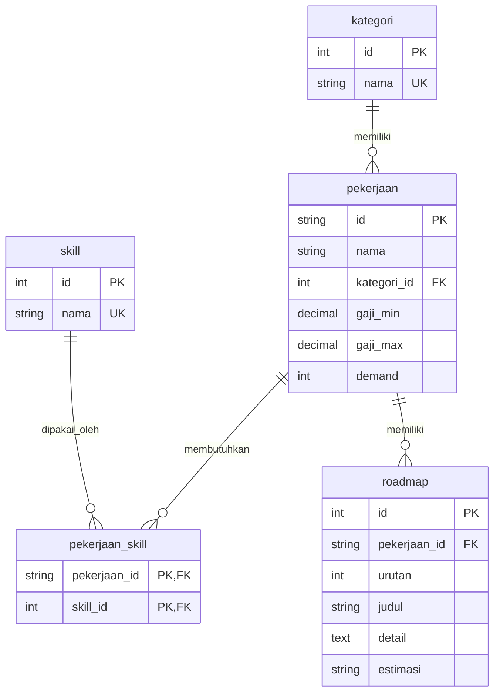

# Entity Relationship Diagram (ERD) — Basis Data Karier IT

Basis data menyimpan **basis pengetahuan** sistem rekomendasi: profil
karier, skill, dan roadmap. Tidak ada data pengguna di sini — akun dan
riwayat tersimpan terpisah di `backend/data/users.json` (lihat
`backend/auth.py`). Skema 3NF, 5 tabel. `seed.sql` digenerate dari
`backend/data/pekerjaan.json` lewat `backend/data/generate_seed.py`.

## Tabel

| Tabel | Kolom kunci | Isi saat ini |
|---|---|---|
| `kategori` | `id`, `nama` (unik) | 5 kategori: Data & AI, Desain & Manajemen, Infrastruktur & Keamanan, Mobile, Web |
| `pekerjaan` | `id`, `nama`, `kategori_id` (FK), `gaji_min`, `gaji_max`, `demand` (1–5) | 23 karier |
| `skill` | `id`, `nama` (unik) | 189 skill |
| `pekerjaan_skill` | `pekerjaan_id` + `skill_id` (PK komposit) | 299 relasi |
| `roadmap` | `id`, `pekerjaan_id` (FK), `urutan`, `judul`, `detail`, `estimasi` | 138 langkah (6 per karier) |

## Catatan

- `pekerjaan_skill` adalah junction table: satu karier punya banyak
  skill, satu skill dipakai banyak karier (many-to-many).
- `roadmap` menyimpan langkah sebagai objek `{judul, detail, estimasi}` —
  format yang sama persis dengan `pekerjaan.json`, sehingga backend
  mengembalikan bentuk yang sama baik dari PostgreSQL maupun dari JSON.
- `UNIQUE (pekerjaan_id, urutan)` menjamin urutan langkah roadmap tidak
  ganda dalam satu karier.
- Seluruh `INSERT` di `seed.sql` memakai `ON CONFLICT DO NOTHING`,
  sehingga seed aman dijalankan berulang kali.
