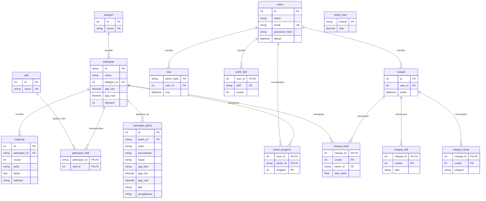

# Entity Relationship Diagram (ERD) — Basis Data Karier IT

Seluruh data persisten aplikasi tinggal di PostgreSQL (15 tabel):
basis pengetahuan (karier, skill, roadmap, bobot, lowongan) dan data
per akun (akun, sesi, skill profil, quest, riwayat). Skema 3NF murni —
tidak ada kolom JSONB atau nilai multi-nilai dalam satu kolom.
Backend tidak membaca file JSON/CSV saat berjalan; file di
`backend/data` hanya bahan seed/dataset (`pekerjaan.json` ->
`seed.sql`, `glints_jobs.csv` -> `load_glints.py`).

## Tabel

### Basis pengetahuan

| Tabel | Kolom kunci | Isi saat ini |
|---|---|---|
| `kategori` | `id`, `nama` (unik) | 5 kategori: Data & AI, Desain & Manajemen, Infrastruktur & Keamanan, Mobile, Web |
| `pekerjaan` | `id`, `nama`, `kategori_id` (FK), `gaji_min`, `gaji_max`, `demand` (1–5) | 23 karier |
| `skill` | `id`, `nama` (unik) | 189 skill |
| `pekerjaan_skill` | `pekerjaan_id` + `skill_id` (PK komposit) | 299 relasi |
| `roadmap` | `id`, `pekerjaan_id` (FK), `urutan`, `judul`, `detail`, `estimasi` | 138 langkah (6 per karier) |
| `bobot_saw` | `kriteria`, `nilai` | 4 bobot: skill 0.45, minat 0.25, gaji 0.15, demand 0.15 (total = 1) |
| `lowongan_glints` | `id`, `karier_id` (FK, boleh NULL bila tidak terpetakan), `judul`, `perusahaan`, `lokasi`, `gaji_teks`, `gaji_min`, `gaji_max`, `tipe`, `pengalaman` | 1.133 lowongan Glints |

### Data per akun

| Tabel | Kolom kunci | Keterangan |
|---|---|---|
| `users` | `id`, `nama`, `email` (unik), `password_hash`, `dibuat` | Password disimpan sebagai hash werkzeug (scrypt), bukan mentah |
| `sesi` | `token_hash` (SHA-256 token), `user_id` (FK), `exp` | Token mentah tidak tersimpan; sesi kadaluarsa 24 jam |
| `profil_skill` | `user_id` (FK) + `skill` (PK komposit), `urutan` | Skill yang disimpan user (bebas, tidak harus ada di tabel `skill`) |
| `quest_progress` | `user_id` + `karier_id` + `langkah` (PK komposit) | Satu baris = satu langkah roadmap yang sudah diselesaikan |
| `riwayat` | `id`, `user_id` (FK), `waktu` | Satu baris = satu hasil rekomendasi; terbaru dulu, maks 50 per akun |
| `riwayat_skill` | `riwayat_id` (FK) + `urutan` (PK komposit), `skill` | Skill yang dipakai pada rekomendasi itu (satu baris per skill) |
| `riwayat_minat` | `riwayat_id` (FK) + `urutan` (PK komposit), `kategori` | Ranking minat pada rekomendasi itu, urutan = peringkat |
| `riwayat_hasil` | `riwayat_id` (FK) + `urutan` (PK komposit), `karier_id` (FK), `skor_akhir` | Hasil ranking pada rekomendasi itu, urutan = peringkat (nama karier diambil dari tabel `pekerjaan`) |

## Catatan

- `pekerjaan_skill` adalah junction table: satu karier punya banyak
  skill, satu skill dipakai banyak karier (many-to-many).
- `roadmap` menyimpan langkah sebagai `{judul, detail, estimasi}` —
  format yang sama persis dengan `pekerjaan.json`, sehingga backend
  mengembalikan bentuk yang sama dari database.
- `UNIQUE (pekerjaan_id, urutan)` menjamin urutan langkah roadmap tidak
  ganda dalam satu karier.
- Seluruh `INSERT` di `seed.sql` memakai `ON CONFLICT DO NOTHING`,
  sehingga seed aman dijalankan berulang kali.
- Hapus akun (`users`) menghapus sesi, skill profil, quest, dan
  riwayatnya (`ON DELETE CASCADE`); lowongan Glints yang terpetakan ke
  karier yang dihapus menjadi tidak terpetakan (`ON DELETE SET NULL`).
